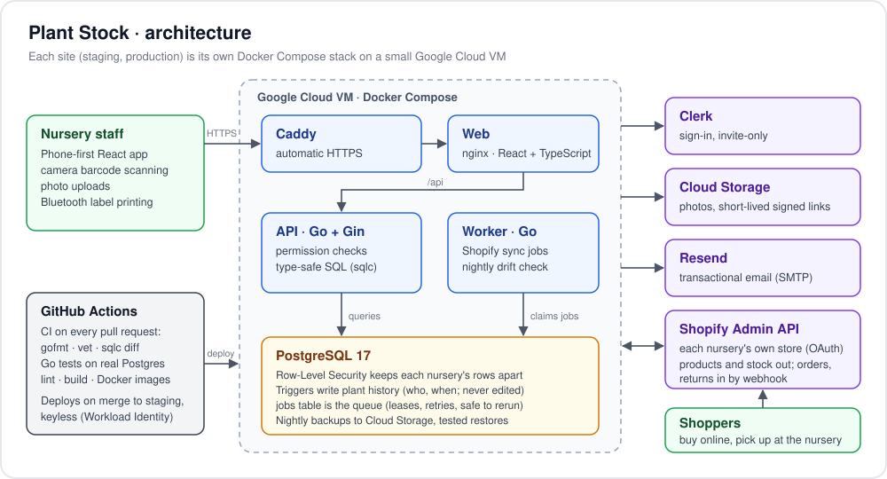
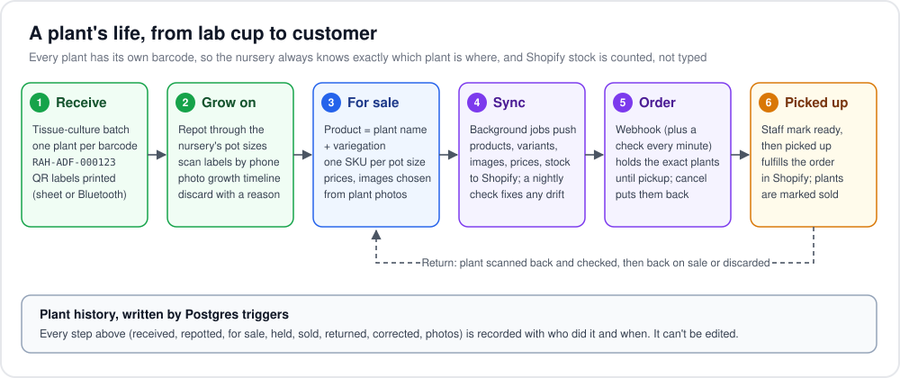
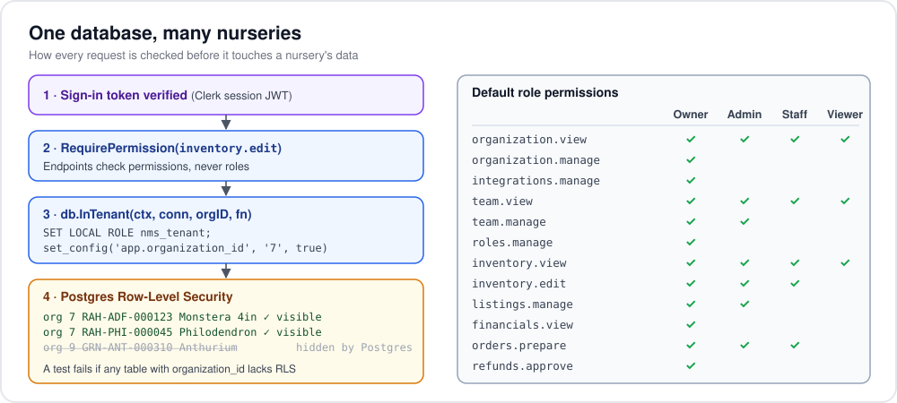

# Plant Stock — inventory for plant nurseries

A multi-tenant web app for independent gardens and nurseries to manage their plant inventory, team,
and photos, and to sell online through their own Shopify store. Root Access HTX (Houston) is the
first nursery on the platform.

See [docs/ROADMAP.md](docs/ROADMAP.md) for decisions, what's built, and what's next.

[](https://github.com/nervster/root_access_inventory_management/actions/workflows/ci.yml)


## Overview

**The problem.** Small nurseries grow plants from tissue culture for months before they can sell them, and
track it all on paper or spreadsheets. When they sell online, the stock in their Shopify store drifts away from
what's actually on the benches, and they oversell or lose track of which plant went to which customer.

**What Plant Stock does.** Every plant gets its own barcode the day it arrives. Staff scan labels with their
phone camera to repot, photograph, or discard plants in the greenhouse. When plants are ready, marking them for
sale creates the products and SKUs, and Plant Stock keeps the nursery's Shopify store in step: products, images,
prices, and stock go out; orders and returns come back in and are tied to the exact plants involved. Plant Stock
is the master record, and Shopify is one sales channel.

**Status.** Running on the staging site with a development Shopify store; the production site comes at launch.
Inventory and the Shopify integration are built; pickup scheduling and locker PINs are next
([roadmap](docs/ROADMAP.md)).

### How it fits together


### A plant's life in the app


### Multi-tenant by design


### Engineering highlights
- **Tenant isolation in the database, not just the code.** Every nursery-owned table has Row-Level Security and
  composite foreign keys on `(organization_id, id)`, so a query that forgets a filter still can't read another
  nursery's data. A test fails if a new table skips it.
- **Permission-based access.** Roles map to permissions and endpoints check permissions, so roles can be
  customized later without touching handlers. Only Owners see financials.
- **Audit trail no one can edit.** Postgres triggers record every change to a plant, with who made it, copied by
  name so history survives people leaving.
- **A job queue in Postgres.** Shopify sync runs as background jobs enqueued in the same transaction as the
  change, with leases, growing retry waits, and handlers that are safe to run twice. A nightly check finds and
  fixes drift between Plant Stock and Shopify.
- **Type-safe SQL.** Queries are plain SQL compiled to Go with sqlc; schema changes are numbered goose
  migrations; CI fails if generated code is out of date.
- **Tests against real Postgres.** No database mocks: each test runs in a transaction that's rolled back.
- **Phone-first.** Built for staff in the greenhouse: bottom navigation, camera barcode scanning, photos uploaded
  straight to storage with signed links, and labels printed to a Bluetooth label printer.
- **Automated delivery.** Every pull request runs CI; merges into `staging` build the images and deploy them to the
  VM, signing in to Google Cloud without a stored key. Nightly database backups, with a script that tests a restore.

## Stack
- **API:** Go + [Gin](https://gin-gonic.com) — `backend/`
- **Web:** React + TypeScript + Vite — `frontend/`
- **Data:** PostgreSQL 17 (also the background-job queue), Valkey (cache), S3-compatible storage (photos)
- **Auth:** [Clerk](https://clerk.com), sign-in only (invite-only)
- **Runs as containers:** one image for the API (and worker), one for the web app; when deployed, a Docker
  Compose stack on a small Google Cloud VM per site (staging, production)

## Layout
```
backend/
  cmd/api/          entry point: main.go wires everything together
  internal/         feature packages (auth/, organization/, inventory/) and shared platform/ code
  internal/db/      Postgres: migrations/ (goose), queries/<domain>/ (SQL) → sqlc generates dbgen/ (never edit)
  Dockerfile        production image (static binary on distroless, non-root)
frontend/
  src/              React app
  Dockerfile        production image (nginx serving the build, proxying /api)
docker-compose.yml  local Postgres, Valkey, photo storage (SeaweedFS), Mailpit (+ optional app containers)
deploy/             staging and production: Compose stack for the Google Cloud VMs, setup scripts, deploy.sh
shopify/            the Shopify apps' settings (scopes, URLs, webhooks), one shopify.app.<site>.toml per app
```

## Prerequisites
- Go 1.27+ ([go.dev/dl](https://go.dev/dl/), macOS ARM64 `.pkg`)
- Node 22+, Docker Desktop
- `cp .env.example .env`, then fill it in (it's git-ignored; the Go API reads it on startup):
  - `CLERK_SECRET_KEY`: Clerk dashboard → API Keys. Also add the session token claims in Clerk
    (Sessions → Customize session token): `{"email": "{{user.primary_email_address}}", "name": "{{user.full_name}}"}`
  - `PLATFORM_ADMIN_EMAILS`: your sign-in email, so you can create nurseries (`/api/platform/...`)
  - `VITE_CLERK_PUBLISHABLE_KEY`: Clerk publishable key (`pk_test_…`), only for building the web container
  - `STORAGE_ENDPOINT=http://localhost:8333`: keeps photos in the local SeaweedFS stand-in (deployed: Google Cloud
    Storage, see `.env.example`)
- `frontend/.env.development.local` (git-ignored) with `VITE_CLERK_PUBLISHABLE_KEY=pk_test_…` for `npm run dev`

## Local development
```sh
docker compose up -d                       # Postgres :5433, Valkey :6379, photo storage :8333, Mailpit :8025
cd backend && make run                     # API on :8080 (`make` lists all backend commands)
cd frontend && npm install && npm run dev  # Vite on :5173, proxies /api to :8080
```
Open http://localhost:5173. Health check: `GET /api/health`. Email the app sends (e.g. invitations) lands in
Mailpit at http://localhost:8025, never in real inboxes. Signed-in user: `GET /api/me`
(send the Clerk session token as `Authorization: Bearer <token>`). Photos go to the SeaweedFS stand-in; the
API creates the `nms-files` bucket there when it starts. Phone cameras (scanning, photos) need https, so locally use
the laptop's webcam at localhost.

The API runs database migrations when it starts. To change the schema or queries (from `backend/`):
```sh
make migration name=create_plants          # new numbered file in internal/db/migrations; fill in Up and Down
# edit SQL in internal/db/queries/<domain>/ (new folder? add it to sqlc.yaml)
make generate                              # regenerate internal/db/dbgen
make migrate-status                        # what has run locally; make migrate-down rolls back the last one
```

Run the production containers locally (web on :8081, API on :8080):
```sh
docker compose --profile app up -d --build
```

## Tests
```sh
cd backend && make test                    # needs `docker compose up -d`; uses a separate nms_test database
```
Tests run against real Postgres (and the photo-storage stand-in for the storage test, which is skipped when
it isn't running), each inside a transaction that's rolled back.
GitHub Actions ([.github/workflows/ci.yml](.github/workflows/ci.yml)) runs the backend checks and tests, the
frontend lint and build, and both Docker builds on every pull request into `staging` or `main`.

## Deploy
Two sites, each a Docker Compose stack ([deploy/compose.yml](deploy/compose.yml): Caddy for HTTPS → web → API,
the worker, and Postgres) on its own small Google Cloud VM (project `plant-stock-rah`), with its own Cloud
Storage bucket for files:

| Site | Address | VM | Shopify | Clerk |
|---|---|---|---|---|
| `staging` | stock-staging.rootaccesshtx.com | `plant-stock-staging` | dev store | test instance |
| `production` | stock.rootaccesshtx.com | `plant-stock-production` | Root Access store | production instance |

Only production may ever connect the real store. From the Mac (needs `gcloud`, signed in):
```sh
deploy/create-vm.sh staging                # once per site: VM, static IP, firewall, then setup-vm.sh on it
cp deploy/.env.example deploy/.env.staging # fill in the site's settings (git-ignored)
deploy/deploy.sh staging                   # build the images here, load them onto the VM, restart
```
SSH goes through Google's IAP tunnel only: `gcloud compute ssh plant-stock-staging --zone us-central1-a --tunnel-through-iap`,
then `cd /opt/plant-stock && sudo docker compose logs -f api`. Merges into `staging` deploy
themselves ([.github/workflows/deploy-staging.yml](.github/workflows/deploy-staging.yml)); settings changes still go
through `deploy/deploy.sh staging` from the Mac, since only the Mac has `deploy/.env.staging`.

Backups: each night (07:00 UTC) the VM dumps the database to its backup bucket (`plant-stock-rah-<site>-backups`,
30 days kept; the VM may only add to it). Set up once per site with `deploy/setup-backups.sh <site>`. Check that the
newest backup restores (into a throwaway database) with `deploy/restore-db.sh staging`; replace a site's database with
`deploy/restore-db.sh staging --replace [backup]`. On the VM: `sudo systemctl start plant-stock-backup` backs up now,
`journalctl -u plant-stock-backup` shows how the last ones went.

Monitoring: `deploy/setup-monitoring.sh <site> you@example.com` (once per site) sets up a Google Cloud uptime check
on `https://<site>/api/health` every 5 minutes, and an alert emailing you when it fails for 10 minutes. A failed
nightly backup emails `ALERT_EMAIL` (set it in `deploy/.env.<site>`) through the site's SMTP settings
([deploy/backup-failed.sh](deploy/backup-failed.sh)). Production deploys like staging, on each merge into `main`
([.github/workflows/deploy-production.yml](.github/workflows/deploy-production.yml)), once
`deploy/setup-github-deploy.sh production` has been run.

Shopify app settings (scopes, URLs, webhook subscriptions) live in `shopify/shopify.app.staging.toml`. Change them
there, then `cd shopify && npm install && npm run deploy:staging`: it shows what changes and, once you confirm,
releases a new version of the "Plant Stock Staging" app. Don't run `shopify app config link` on an existing file:
it overwrites it with what Shopify has. Webhooks go to `POST /api/shopify/webhooks`; the worker still checks for
orders each minute, in case one is missed.

Email goes through Resend's SMTP (`smtp.resend.com:587`, user `resend`, password a sending-only API key per site) from
`no-reply@rootaccesshtx.com`. The domain's DNS lives in Shopify (Settings → Domains); Resend's records there are
`resend._domainkey` (TXT) and the `rsend` and `send` CNAMEs. Sent mail and bounces show in Resend under Emails.

## Working from GitHub issues
Open an issue with the Bug or Feature template, then add the `claude` label to hand it to Claude
([.github/workflows/claude.yml](.github/workflows/claude.yml)). Claude comments its plan and progress on the
issue, branches `feature/*` off `staging`, runs the same checks as CI, and opens a PR into `staging`. Ask for
changes by commenting `@claude …` on the PR. Only people with write access can trigger it; it runs on the Claude
subscription behind the `CLAUDE_CODE_OAUTH_TOKEN` secret, and follows [CLAUDE.md](CLAUDE.md).
